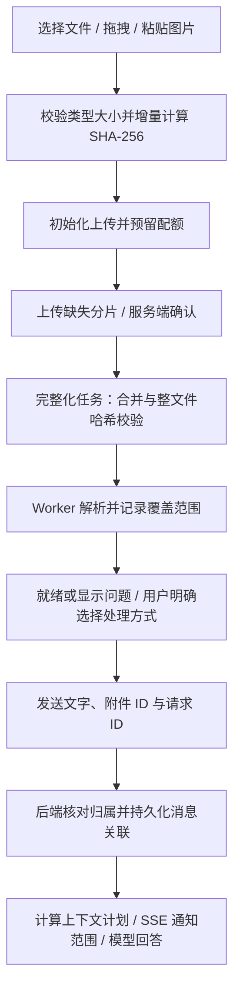

# 通用聊天附件详细设计

日期：2026-10-30。状态：拟实施方案，尚未实现、压测或验收。关联：[模块待办](chat-attachments-tasks.md)、[测试方案](chat-attachments-test-plan.md)。

## 1. 目标与边界

支持聊天中选择、拖拽文件与粘贴图片，覆盖 JD、简历优化和面试聊天。用户始终能区分：允许上传、上传完成且校验通过、解析结果、实际用于模型的范围。禁止静默丢附件、吞解析错误或截断全文后声称全文分析。

采用现有 FastAPI + SQLite + 本地受控文件目录，同机独立 Worker 处理解析。初期不引入独立文件服务器、MCP、Skills、Redis或向量数据库；存储接口保留对象存储替换能力。大文件分片与完整性校验属于基础交付，不能只放宽文件选择框。

现状（只做了静态代码核对）：`resumes.py` 接收 PDF/TXT/DOCX，一次读入原文件并提取段落文本；聊天 `content` 是字符串；`useStreamChat` 和 ChatInput 拒绝空文字发送；`chat.py` 从数据库重建历史。既有简历上传具有创建版本/切换 active 的业务副作用，因此只抽取解析公共函数，聊天附件不能调用简历上传接口。此次不变更现有业务实现。

## 2. 文件范围与拟定限额

以下为第一版配置起点，不是已经测得的容量承诺。按测试方案测量后再调整；前端从能力接口获取实际值，后端始终兜底。

| 项目 | 初始设计值/行为 |
|---|---|
| 文本文档 | TXT、MD、DOCX、文字型 PDF；每文件最多 100 MiB |
| 图片 | PNG、JPEG、WebP；每文件最多 20 MiB、解码后最多 2500 万像素 |
| 扩展格式 | DOC 通过受控转换器转换；扫描 PDF/图片 OCR；作为第二阶段，未部署依赖时明确不可用 |
| 单条消息 | 最多 5 个附件，原文件大小之和最多 200 MiB |
| 用户配额 | 原件及在途预留共 1 GiB；派生文件另计物理磁盘配额，不可无限增长 |
| 上传并发 | 每页最多 2 个文件，每文件最多 2 个分片；服务端每用户最多 4 个活跃上传 |
| 分片 | 固定 4 MiB，末片按剩余长度，小文件同协议一个分片 |
| 文档解析上限 | PDF 最多 500 页；文本提取最多 500 万字符；达到上限进入受限状态，禁止标记完整 |
| DOCX 防膨胀 | 解压总量最多 200 MiB、最多 10000 个条目，并限制单条目大小 |
| Worker | 初始 1 个解析子进程；单任务 120 秒，OCR 任务 600 秒，内存预算初拟 512 MiB，需目标系统验证强制限制方式 |
| 生命周期 | 未完成上传 24 小时过期；未关联附件 7 天过期；已关联附件跟随聊天保留 |

空文件、加密 PDF、损坏文件、压缩包、可执行文件明确拒绝或进入可解释的解析失败状态。DOC 不能通过改后缀当 DOCX 处理。能力接口按部署实际依赖返回 enabled/reason，不能提供实际上不可用的上传选项。

## 3. 端到端流程

前端 Web Worker 按块读取文件、增量计算 SHA-256，不把整文件转 base64 或一次读进 JS 内存；算法实现选型需独立验证。计算阶段显示“正在校验本地文件”，上传阶段显示“服务器已确认 X / Y”。哈希计算不会上传敏感内容到第三方。

## 4. API 契约（拟新增）

所有业务接口复用当前认证和页内请求身份。所有 upload_id、attachment_id、session_id 均在后端核对所有者；不可用随机 ID 代替授权。二进制接口不依赖可自动继承的浏览器身份。

| 接口 | 请求/返回与语义 |
|---|---|
| GET `/api/attachments/capabilities` | 格式能力、单文件/消息/配额限额、分片大小、可用解析及模型模式 |
| POST `/api/attachments/uploads` | `{client_upload_id, filename, size_bytes, sha256, declared_media_type}`；返回 upload_id、attachment_id、chunk_size、expires_at；按用户+client_upload_id 幂等，相同键不同内容 409 |
| GET `/api/attachments/uploads/{id}` | 返回已确认分片序号、字节数、状态及过期时间 |
| PUT `/api/attachments/uploads/{id}/chunks/{index}` | `application/octet-stream`，头 `X-Chunk-SHA256`；后端限长流式落临时文件并计算哈希，匹配后提交；同序号同哈希成功，不同内容 409 |
| POST `/api/attachments/uploads/{id}/complete` | 检查分片清单，缺片返回 409+missing_indices；完整则 202 排队校验；重复调用返回同一状态，不重复生成任务 |
| DELETE `/api/attachments/uploads/{id}` | 幂等取消，撤销任务、分片和预留；迟到写入不得复活任务 |
| GET `/api/attachments/{id}` | 文件元数据、传输/解析状态、页数、警告、失败原因、结果版本及允许操作 |
| GET `/api/attachments/{id}/preview?cursor=...` | 授权后的分页纯文本与页码，不返回内部路径；不直接执行 HTML/Markdown |
| GET `/api/attachments/{id}/download` | Axios 携带当前页 Bearer 获取 Blob 下载；附件响应，不放公共静态目录，不在 URL 中放 Token |
| POST `/api/attachments/{id}/retry` | 在允许状态创建新解析 generation；重复请求不得并发解析同一版本 |
| DELETE `/api/attachments/{id}` | 未关联附件可删除；已关联默认 409，需走显式删除聊天/关联生命周期，不能通过移除草稿破坏历史 |

统一错误 `{code, message, retryable, details, request_id}`；413 超大小、415 格式不支持、422 文件损坏/校验失败、409 状态冲突、410 上传过期、429 限流、503 临时资源不足；越权与不存在统一 404。401 由现有认证机制处理。代理大小限制至少允许一个分片加协议开销，部署时与应用上限共同验证；不能只检查 Content-Length，实际接收字节也必须限流限长。

## 5. 上传完整性、重试与恢复

1. 初始化通过短事务原子预留声明大小；重复幂等请求不重复扣配额。服务器生成目录与存储键，原始文件名仅用于展示。
2. 每片在独立临时文件写完且哈希正确后再提交清单。唯一约束 `(upload_id, index)` 处理并发；失败临时文件由回收任务处理。
3. complete 先将上传状态原子冻结，拒绝新增分片，再创建持久任务。Worker 按序流式合并，验证总大小和整文件 SHA-256；成功后原子重命名到最终存储位置。整文件不符不得解析。
4. 文件系统和 SQLite 不可能共享一个原子事务：采用 staging/committed 状态、确定性文件名和对账回收。崩溃后检查已有最终文件、哈希和数据库状态，再恢复或重做，不能只看文件存在。
5. 网络错误、408、429、5xx 可重试，最多 3 次，退避并加抖动，遵守 Retry-After；PUT 重传同一片。complete 响应丢失先 GET 状态。身份失效停止；用户取消不显示为普通失败。
6. 当前页可自动继续。刷新后文件对象不能假定还在：用户重新选择文件，增量哈希匹配后，登录同一账号查询原 upload_id 并只补缺片。第一版只持久化非内容上传句柄并绑定 user_id；不存 Token、文件本体或附件文本。普通新标签页不自动继承草稿或身份；可在认证后通过本人上传任务列表恢复。
7. 退出/身份变化立即 Abort 并丢弃旧身份异步回调；服务器可能已接收的部分保持可回收状态。暂停保留分片，取消请求清理；两者文案不同。

## 6. 状态、数据模型与 Worker

传输状态：`uploading -> verifying -> uploaded`，另有 `paused（客户端） / failed / canceled / expired`。解析状态独立：`pending -> queued -> processing -> ready | partial | needs_ocr | failed | unsupported`。页面组合显示，只有 uploaded 才可安排解析。

| 拟新增表 | 核心字段与约束 |
|---|---|
| attachments | id、user_id、原名、检测类型、size、sha256、storage_key、upload_status、parse_status、result_version、warnings、覆盖统计、时间与删除标记 |
| attachment_uploads | attachment_id、client_upload_id、chunk_size/count、expires_at、reserved_bytes、state/version；用户+client_upload_id 唯一 |
| attachment_chunks | upload_id、index、size、sha256、storage_key；upload_id+index 唯一 |
| attachment_jobs | attachment_id、kind（finalize/parse）、generation、status、attempt、lease_owner/token、lease_until、heartbeat、error；附件+kind+generation 唯一 |
| attachment_segments | attachment_id、result_version、ordinal、page/section、text、token_estimate、warnings；支持分页预览与后续检索 |
| chat_message_attachments | message_id、attachment_id、result_version、顺序及展示快照；同消息同附件唯一 |

聊天还需持久化 `client_request_id`、生成状态和本轮 context_usage（附件版本、所用页/片段、模式、警告）。新会话重试也用用户+client_request_id 唯一的请求记录映射到 session/message，避免“创建会话响应丢失”重复创建。现有五张业务表不删除，旧消息附件数组默认空。

SQLite Worker 采用数据库持久队列；短写事务领取任务和租约、提交后再做磁盘/解析工作。严禁在合并、解析、模型请求期间持有写事务。心跳续租；过期租约可回收，最多 3 次自动重试；提交结果用 lease token+generation 比较，拒绝迟到 Worker 覆盖新结果。子进程受超时和资源限制，退出后必须回收子进程树。Windows 上进程及内存限制的实现是上线前验证项，不能仅在配置中写一个数字。

定时维护支持默认 dry-run：清理过期分片、孤儿文件、临时结果和无关联附件，释放预留；已关联原件不因解析失败自动删除。取消/删除与 Worker 完成竞争时，以删除标记及 generation 为准。磁盘保留安全水位，合并时考虑“分片+原件+派生文件”的临时空间，空间不足拒绝新任务而不是写到半途。

## 7. 解析与模型上下文

TXT/MD：明确 UTF-8/BOM 支持；无法解码时报错或让用户选择编码，禁止 errors=ignore 无声丢字。保留原始文本；展示 Markdown 时禁用原始 HTML。

DOCX：按文档顺序提取正文和表格；记录页眉页脚、文本框、图片等支持范围，不能仅提取段落却显示全部内容完整。PDF：逐页记录文本与异常；空白页/纯图片页标记“未提取到文本，可能需 OCR”，不把所有空页断言为失败。提取覆盖率只是处理统计，不是语义正确率。

第二阶段 DOC：限定转换器版本、禁网络和宏、隔离临时目录、限时限内存；转换后仍记录布局可能变化。OCR 保留页码及失败页；无法获得可靠置信度时不编造百分比。图片只做 OCR 时说明只能识别文字；理解图表/布局需要实际可用的视觉模型适配器。OpenAI 兼容接口不等于必然支持图片或原生 PDF，需对配置的真实提供方验证，不读取/公开真实密钥。

上下文模式分两期：

- 第一阶段 `full_text`：解析文本在本轮预算内才允许全文发送，文案为“已提取文本全文参与”，不声称图片、版式均已理解。超限返回 `CONTEXT_BUDGET_EXCEEDED`，提供移除附件/缩小内容等选择，绝不静默裁切。
- 第二阶段 `retrieval` / `section_summary`：用户明确选择相关片段问答或分段总结。检索可先实现简单本地索引，不预设必须向量数据库。每段保存来源；检索回答显示来源页/章节，不声称全文检查；分段总结需每段任务结果齐全，缺失则标记不完整。

预算由服务器按提供方已验证的上下文容量、历史、系统指令、简历/JD 上下文、输出预留和附件共同计算。无可靠 tokenizer 时使用保守估算并说明；模型拒绝超长仍返回明确错误，不能偷偷丢尾部。历史附件按数据库关联与版本重新解析范围，不依赖前端重发全文，也不在每轮机械重复拼接所有附件。

附件是用户提供的数据，不能插入为系统级指令；文件中的“忽略之前指令”等内容不触发工具调用。引用只从服务器已有片段映射，不允许模型指定任意文件路径。

## 8. 聊天协议与界面

保留现有 messages 字段兼容旧客户端；新增本轮 `attachment_ids`、`client_request_id`、`context_mode`、`accepted_partial_versions`。附件只关联当前新消息，不把顶层 IDs 隐式关联到所有历史消息。无文字但有就绪附件允许发送，UI 可提示补充问题；后端不能再只从非空文字决定是否保存消息。

发送前检查所有者、状态、数量、总大小、解析版本和预算。partial 只有用户查看警告并确认对应版本后才能发送，其他未完成状态阻止；服务器复核以防状态竞争。消息、附件关联及幂等请求记录在同一短事务写入后再调用模型；新会话的建立也纳入一致性设计。

SSE 保留 token、structured、done，增加 `attachment_context` 事件，携带本次真正使用的附件、结果版本、范围、模式与警告。发送模型前确定并记录计划；模型失败显示“已准备上下文，回答失败”，不宣称已完成分析。重试同 client_request_id 不重复入库或生成；处理中返回 409+查询信息，结束后通过历史读取结果；显式重新生成使用独立生成 ID。

界面卡片显示原名、大小、状态、服务器确认字节、校验进度阶段、解析页数、失败原因、重试/暂停/取消/预览。进度到 100% 后仍显示“校验中”，不能直接变“可发送”。不提供虚构的实时百分比。失败/处理中附件阻止发送；用户必须主动移除才能仅发送文字。

历史消息显示附件与本轮使用范围；“从输入框移除”只移除草稿引用，清理未引用原件遵循保留规则。移动端卡片可换行、不撑宽页面；按钮有键盘操作和无障碍名称；状态变化使用低频 live region，避免每片播报。

## 9. 发布与运行边界

功能开关默认关闭；先添加迁移和后端能力，再启用前端。迁移仅对确认的目标库执行，先备份；本文不执行迁移。关闭功能开关停止新上传，但保留历史附件查看和数据；回滚程序不得删除已存文件/关联。

日志只记 request_id/upload_id、字节计数、阶段耗时和错误码，不记录文件内容、Token、Cookie。观察上传失败率、校验失败率、解析队列等待、任务重试、存储使用量、SQLite 锁等待及聊天延迟。待真实并发与容量测量后决定何时迁移对象存储、独立 Worker 主机或外部队列。
