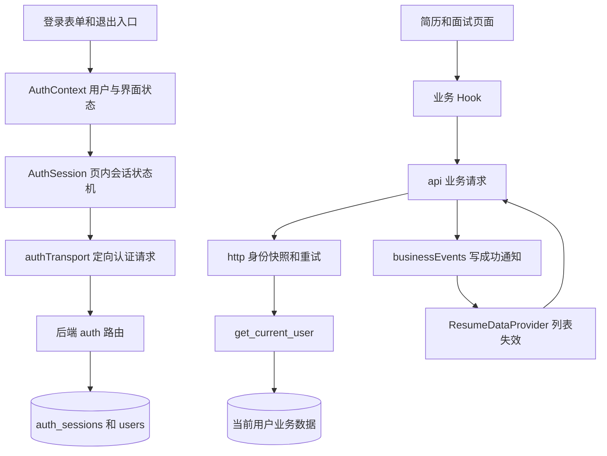

# AI Career 标签页独立登录模块详细设计

日期：2026-10-27。状态：代码已实施，完整验收未完成。实际结果见 [本轮记录](verification/tab-session-isolation-2026-10-27.md)。本设计细化 [标签页独立登录改造方案](tab-session-isolation-design.md)，以当前工作区代码为基线，以下为目标契约，具体实现与验证边界以本轮记录为准。

首版采用页面内存身份、会话专属 Refresh Cookie、页内认证协调和独立业务通知。整页刷新后重新登录；同一文档内路由跳转保持登录；同账号跨页共享服务端简历，但不共享凭证、JD 草稿或选中项。继续使用 SQLite 和现有 auth_sessions 表。

## 1 模块边界和调用链



上图通知仅由简历写接口成功触发；列表 GET 不发布事件，因此不会形成广播循环。

| 模块 | 当前实现与缺口 | 目标责任 |
| --- | --- | --- |
| authSession.ts | 全站频道、锁、启动问询 Token | 唯一页内凭证源、认证队列、请求身份快照 |
| http.ts | 只有请求前与 401 的部分 sid 比较 | 所有业务请求的发出、成功、失败、重试都校验身份 |
| AuthContext.tsx | 启动 refresh；订阅与 login 都可能请求 /me | 用户资料唯一加载入口，明确登录中、退出中、恢复中 |
| App.tsx | 每条业务路由分别保护 | 一个受保护路由分组和按 sid 固定的业务状态边界 |
| jdStorage.ts | 全账号共用 localStorage | 当前认证会话的内存缓存 |
| useResumePage 与 useInterviewPage | 各自请求列表，后者吞掉加载错误 | 共用 Provider，页面各自管理选择和草稿 |
| useResumePage | 写操作与后续 GET 共用 catch | 区分写入结果和列表同步结果 |
| 聊天与语音 Hooks | 部分清理已有，迟到响应保护不完整 | 身份、组件和操作三层生命周期检查 |
| 后端 auth.py | 新登录撤销共享 Cookie 会话 | 新建独立会话，定向刷新与撤销 |

## 2 统一类型和不变量

新增 `frontend/src/lib/authTypes.ts`，供状态机、传输层和 React 使用，避免各处重复 TokenResponse。

```ts
interface TokenResponse {
  access_token: string
  token_type: 'bearer'
  expires_in: number
  session_id: string
}

interface IdentitySnapshot {
  epoch: number
  sessionId: string
  userId: string
  requestGeneration: number
}

type AuthPhase =
  | 'anonymous' | 'authenticating' | 'identifying'
  | 'authenticated' | 'revalidating' | 'loggingOut'
  | 'identityError' | 'logoutUncertain'
```

这里的 `sessionId` 专指认证会话；聊天接口的 `session_id` 继续表示聊天会话，局部变量统一命名为 `authSessionId` 和 `chatSessionId`。

必须成立的约束：

1. sessionId、Access Token、userId 作为一组更新；不能通过单独的 setAccessToken 切换身份。
2. 登录接受响应时验证 token_type、expires_in、session_id 格式以及 JWT 的 sid、sub、exp 结构。刷新还必须验证 sub 等于原 userId。前端解码仅作一致性检查，签名与授权仍由后端验证。
3. `epoch` 在建立新身份、清除身份、销毁实例时改变；同 sid 刷新 Token 不改变 epoch，不重挂业务组件。
4. `requestGeneration` 在退出开始、恢复校验开始时递增，用于淘汰此前业务请求；退出失败可保留身份，但已取消请求不会复活。
5. 没有内存 sessionId 时不发 refresh。页面不扫描 Cookie、不访问旧 JD、不读取其他页凭证。
6. 每次响应更新 UI 前必须仍属于相同身份及相同操作。仅比较 userId 不够，同账号重新登录也必须隔离。

## 3 后端认证模块

### 3.1 文件和函数划分

修改 `backend/app/routers/auth.py`、`backend/app/schemas.py`；新增 `backend/app/services/auth_sessions.py` 承载会话查询、创建与撤销。新增 services 包时补 `__init__.py`。路由只负责参数、CSRF、Cookie、HTTP 返回；服务层不依赖 Response。

| 函数 | 输入 | 输出与副作用 |
| --- | --- | --- |
| validate_session_id | 路径字符串 | 校验为 32 位小写十六进制，非法返回 422 |
| refresh_cookie_path | 已校验 sid | `/api/auth/sessions/{sid}/` |
| set_session_cookie | Response、sid、原文、剩余秒数 | 设置唯一名称、精确 Path 的 Cookie |
| clear_session_cookie | Response、sid | 仅删除相同名称与 Path 的 Cookie |
| create_login_session | db、user_id | 返回新会话和临时 Refresh 原文，提交后才设置 Cookie |
| validate_refresh_session | db、sid、Cookie 原文 | 按主键查会话、验证哈希、有效期、用户 |
| revoke_login_session | db、sid、Cookie 原文 | 返回成功或认证失败，仅定向删除 |

格式沿用当前 `models/base.py` 的 `uuid.uuid4().hex`。不得把带斜线、编码路径片段或未校验输入直接拼入 Cookie Path。Refresh 原文继续用 `secrets.token_urlsafe(48)`，只存 SHA-256 哈希，比较用 `secrets.compare_digest`。

### 3.2 接口契约

| 请求 | 成功 | 失败与行为 |
| --- | --- | --- |
| POST /api/auth/register | 201 UserOut，无会话 | 原有 409、422、403 保持 |
| POST /api/auth/login | 200 TokenResponse，新增 session_id | 401 凭证错误；409 会话上限；失败不设置新 Cookie |
| POST /api/auth/sessions/{sid}/refresh | 200 同 sid TokenResponse | 401 Cookie 无效、会话到期或用户不存在；422 sid 非法；403 CSRF 错误 |
| POST /api/auth/sessions/{sid}/logout | 204，精确清 Cookie | 有效目标但 Cookie 缺失或不匹配返回 401，不删除记录 |
| GET /api/auth/me | 当前 Bearer 对应 UserOut | 保持原有 JWT 和数据库会话验证 |
| POST /api/auth/refresh 与 /logout | 410 | 明确提示“认证协议已更新，请刷新页面重新登录”，不选择任何新会话 |

Cookie 名称为 `ai_career_tab_refresh`。登录响应包含 HttpOnly、SameSite=Strict、配置化 Secure、固定 Max-Age，不设置 Domain。refresh 不重新设置 Cookie、不旋转 Refresh 原文、不修改 expires_at。认证成功与失败响应均设置 `Cache-Control: no-store`，Token 响应保留 `Pragma: no-cache`。

Cookie Path 控制请求携带范围，不构成同源脚本之间的安全边界；同名 Cookie 可按不同 Path 共存。本方案的定向验证必须同时匹配 sid 与 Refresh 哈希。[MDN Set-Cookie](https://developer.mozilla.org/en-US/docs/Web/HTTP/Reference/Headers/Set-Cookie)

### 3.3 登录和刷新顺序

登录：校验 Origin/保护头 → 校验账号密码 → 在短事务内检查上限并创建会话 → 提交 → 设置该 sid Cookie → 返回绑定 sid 的 JWT。删除原 `revoke_cookie_session` 调用，不能按旧 Cookie 撤销其他标签页。

刷新：校验 Origin/保护头 → 校验 sid 格式 → 按 sid 取记录 → 校验未过期和 Cookie 哈希 → 查用户存在 → 签发 Token。所有认证无效情况统一 401 文案，不能按全表哈希匹配后替换路径中的 sid。

同一个 sid 并发刷新可返回不同 JWT，但均绑定原 sid；跨 sid 刷新相互独立。刷新与退出在服务器并发时，即使刷新迟到返回 JWT，也必须因会话已删除而无法通过后续业务鉴权，不能重新插入会话。

### 3.4 退出判定

| 数据库目标 | Cookie | 处理 |
| --- | --- | --- |
| 不存在 | 任意 | 204，清目标 Path Cookie |
| 已过期 | 任意 | 204，可清理该过期记录并清目标 Cookie |
| 未过期 | 正确 | 条件删除该 sid 与哈希，提交后 204 并清 Cookie |
| 未过期 | 缺失或错误 | 401，不清目标 Cookie、不撤销任何记录 |

logout 不依赖 Access Token，避免 Access 过期阻止退出。数据库提交失败返回服务器错误，不先发成功删除 Cookie。删除是幂等的，重复退出不会误操作其他 sid。旧名称 Cookie 仅可按旧 Path `/api/auth` 清理，不做新 Cookie 的全量清扫。

### 3.5 依赖和数据模型

`backend/app/deps.py` 保留当前验证链：JWT 签名与类型 → claims.sid 查 auth_sessions → session.user_id 等于 claims.sub → 会话未过期 → 用户存在。简历、聊天、STT、TTS 继续依赖它。注销后的下一次鉴权必须失败，已通过鉴权并开始执行的请求不保证撤回。

现有 auth_sessions 已继承 id、created_at、updated_at，拥有 user_id、refresh_hash、expires_at；本次不新增表字段、不生成迁移。现有建表迁移必须已经在目标环境完成，这与本次设计无需新迁移是两回事。

## 4 会话上限和事务

在 `backend/app/config.py` 增加 `auth_max_active_sessions_per_user`，开发建议值 20，正整数校验；上线数值以压测后配置为准。计数对象为同账号所有未过期登录会话，包括其他设备和失去页面引用的会话。达到上限返回 409 与可读文案；不自动挤掉任何未过期会话。过期记录不计数。

不能使用“先 count，再独立 insert”实现硬上限：多个并发登录可能一起通过检查。SQLite 实施方案为独立短写事务：密码验证完成后结束此前读事务，在专用新会话中先 `BEGIN IMMEDIATE`，重新确认用户和账号凭证仍有效，再 count、insert、commit；失败 rollback。不要在 get_db 已自动开启的事务里嵌套 BEGIN，不在锁内执行密码哈希或网络请求。锁冲突返回可重试 503，不静默绕过上限。SQLite 的 IMMEDIATE 事务可能遇到 SQLITE_BUSY，需以真实 SQLite 多连接测试验证。[SQLite 事务说明](https://www.sqlite.org/lang_transaction.html)

未来启用 PostgreSQL 时必须实现同账号用户行锁后 count/insert 的对应策略，并让所有会话创建路径遵循它；本次不把 SQLite 专用 SQL 无条件用于其他数据库。

过期清理只删除 `expires_at <= now` 的记录，使用显式维护命令并报告条数。后端不能替浏览器批量清理未知 Path Cookie；它们按固定期限自然到期。每用户上限也不能保证整个站点 Cookie 配额不被多账号耗尽。压测必须包含页面刷新后再次登录造成的孤立会话；达到上限的用户只能退出仍打开的会话、等待过期或经明确运维流程撤销，本期不增加会话管理页面。

## 5 前端认证状态机

### 5.1 AuthSession 的接口

重构 `frontend/src/lib/authSession.ts`，保留单实例，但删除 channel、lock、askPeer、peerWaiters 和认证消息处理；不再调用 navigator.locks。

```ts
getSnapshot(): AuthSnapshot
subscribe(listener: () => void): () => void
captureIdentity(): IdentitySnapshot
isCurrent(snapshot: IdentitySnapshot): boolean
login(credentials: LoginInput): Promise<void>
refresh(options?: { rejectedToken?: string; force?: boolean }): Promise<string>
logout(): Promise<void>
revalidate(): Promise<void>
invalidate(reason: string): void
dispose(): void
```

`AuthSnapshot` 包含 phase、sessionId、userId、epoch、requestGeneration 和可展示错误；UI 无须订阅 Token 原文。`getToken()` 仅供网络层内部读取。删除对外任意 `accept(token)` / `setAccessToken` 的使用，测试通过登录 transport 或显式测试夹具建立身份。

新增 `frontend/src/lib/authTransport.ts`，使用无业务拦截器的 Axios 实例执行 login、refresh、logout；baseURL=/api、Fetch adapter、withCredentials=true、10 秒超时和保护头保持。它不导入 AuthSession。抽取 `httpErrors.ts` 共享错误解析，避免 transport 与 http 互相依赖形成递归刷新。

### 5.2 状态转换

| 当前状态和事件 | 下一状态 | 业务准入 |
| --- | --- | --- |
| 新页面 | anonymous | 拒绝受保护请求，不调用 refresh |
| anonymous 提交登录 | authenticating | 禁止重复提交 |
| 登录返回通过一致性校验 | identifying | 只允许内部 /me 和退出 |
| /me 成功且 id 匹配 sub | authenticated | 允许业务 |
| /me 网络失败或 5xx | identityError | 保留 sid，允许重试资料加载或退出，不再次创建会话 |
| authenticated 定时 refresh | 保持 authenticated | 有效 Token 可继续使用；需要刷新者共享 Promise |
| 确认认证失效 | anonymous | 清身份并卸载业务 |
| authenticated 点击退出 | loggingOut | 立即关闭新请求入口 |
| logout 204 | anonymous | 清凭证、缓存和业务子树 |
| logout 网络失败或 5xx | logoutUncertain | 保留身份与草稿，等待重试退出或主动验证会话 |
| BFCache 返回 | revalidating | 验证前禁止业务提交 |

退出失败并不证明服务端未删除记录。logoutUncertain 显示“退出结果未确认”；可用原 sid 再次退出，204 后清理；也可由用户选择验证后继续，强制定向 refresh 成功才恢复 authenticated，401 清理本页。不得仅凭仍在内存的 Token 自动认定会话有效。

### 5.3 页内串行和去重

认证 transport 操作通过一个 Promise tail 排队；tail 使用 catch 吸收上次失败，使后续工作可执行。刷新另有 `pendingRefresh`，并发调用者返回同一 Promise。提交登录时在入队前设置 authenticating，队列执行前再次校验 anonymous，防止双击排入两次登录。

退出开始同步设置 gate=closed、递增 requestGeneration、停止刷新定时器、取消业务请求。等待已开始的认证操作结束，再对点击时捕获的 sid 发 logout；已排队但未开始的刷新在出队后检查退出标记并取消。正在刷新的返回可以在身份仍匹配时内部接收，但不能解除 loggingOut 或重新启动计时器。队列内不调用再次入队的公共方法，避免自我等待。

pending 的 finally 只清理自身 Promise，不能清掉后续身份创建的新 pending。dispose 时递增 epoch，取消定时器和 transport，后续响应全部丢弃；HMR 新实例为未登录，AuthProvider 订阅当前快照后同步清旧 user。

### 5.4 刷新规则

沿用提前 60 秒、后台暂停定时器、可见后补检、临时失败 5 秒起指数退避且最多 60 秒。退避仅本页保存。无 sid、正在退出或身份不一致直接拒绝，不探测其他 Cookie。

401 触发 refresh 时传 rejectedToken：若已有更晚且仍有效的 Token，可以复用；否则不得返回被拒绝的旧 Token。refresh 的 401 或响应 sid/sub 不匹配使本页失效；403 显示认证配置错误并阻止继续刷新，不进入普通离线退避循环；网络与 5xx 在 Token 尚未过期时可继续使用旧 Token，到期后显示恢复状态。

### 5.5 页面生命周期

focus、online、visibilitychange 只检查本会话，不改变身份。监听 pageshow，当 persisted=true 且存在内存身份时强制定向 refresh，不走“Token 足够新就直接返回”的分支。pagehide 时关闭业务入口并取消进行中的 UI 操作，pageshow 校验后恢复；无身份的新文档始终停在 anonymous。pageshow 的 persisted 可用于识别缓存恢复事件。[MDN pageshow](https://developer.mozilla.org/en-US/docs/Web/API/Window/pageshow_event)

BFCache 恢复可保留同一文档内存，因此“新文档重新登录”和“存活文档恢复后验证”是不同分支。关闭后恢复的具体浏览器行为纳入实测；若产品要求一切历史恢复都必须重登，应另行修改这条规则。

## 6 HTTP 和业务 API

### 6.1 请求快照与取消

`http.ts` 为业务请求附加内部元数据 `{identity, authRetried, internalIdentityRead}`，重试必须保留最初 identity，不重新捕获新账号。`internalIdentityRead` 仅由 /me 封装使用，允许 identifying 状态加载资料，不能成为任意 URL 绕过入口。

请求发出前：捕获身份 → 校验 gate → 必要时等待本页 refresh → 再次检查 epoch、sid、requestGeneration → 添加当前同身份 Bearer。无身份时直接产生认证错误；新登录以后不能自动接续匿名时提交的旧操作。

增加成功响应拦截器，在交给调用方前校验快照；错误分支先校验身份，再决定 401 重试或显示错误。身份不匹配统一转 Axios CanceledError，不能清除新账号，也不能弹旧账号的失败 Toast。

增加 `requestScope.ts` 维护当前身份下的 AbortController 集合，合并调用方 signal；退出、失效、恢复校验或卸载可取消。普通请求完成后注销；SSE 必须保留注册到流消费结束，由流 Hook 在 finally 释放，不能收到响应头就注销。移除合并 signal 的事件监听，避免长期累积。

### 6.2 401 重试顺序

1. 校验仍为原始身份且 gate 可用；已取消直接结束。
2. 释放失败响应的 ReadableStream，解析或丢弃错误体。
3. 未重试过则标记 authRetried，调用 refresh(rejectedToken)。
4. 刷新结束再次校验身份、signal、gate，用新 Token 重发原请求一次。
5. 第二次 401 仅使仍匹配的当前身份失效；不处理另一个 epoch 的状态。

认证 transport 不安装这套拦截器，避免 login 401 刷新或 refresh 401 递归。公开 register 也使用无业务认证链的请求，保留保护头。业务 403 不自动刷新。

JSON、FormData 自动 boundary、204、Blob/流错误体和 Axios 取消标记沿用。仅在请求被明确 401 拒绝时自动重试一次；上传等写操作的网络超时不自动重传。

### 6.3 API 签名

`api.ts` 的业务 API 增加可选 `{signal?: AbortSignal}`，覆盖 /me、简历读写、聊天历史、STT、TTS；apiStreamChat 保持 signal 必填。TokenResponse 从 authTypes 导入，不再两份定义。认证 URL 只能由 `authSessionUrl(validatedSid, action)` 生成。

简历写成功通知统一放在 api 层的公共写函数尾部：上传、创建版本、删除、修改标题或 is_active。调用时捕获 identity；成功后仍属于原身份才触发本页失效与广播；通知异常单独捕获，不改变写操作 Promise 的成功结果。UI 不再次广播。

后续本页列表 GET 失败单独标记同步错误，不能进入“上传失败”分支。超时或身份取消导致写结果未知时，保留可重试提示，通过 GET 对账，不声称后端已回滚。

## 7 AuthContext 和路由

`AuthContext.tsx` 订阅 AuthSession 快照，初始 user=null、loading=false，不调用 refresh。由唯一的 `ensureUser(identity)` 负责 /me，按 epoch/sid 共享 Promise；登录函数与订阅即使同时调用，也只发一次。成功要求 response.id 等于 token.sub，旧 Promise 不更新 user。

上下文增加 phase、sessionId、authError、retryIdentity、canSubmit；loading 只表示首次登录资料尚未准备好。后台 Token 刷新不能让 loading=true 导致页面卸载。退出中、退出未确认、BFCache 校验中仍保留业务树和草稿，用覆盖层或禁用态阻止提交；确认失效后才清除。

`App.tsx` 把 jd、resume、interview、interview/end/:sessionId 放入一个无 path 的受保护父路由，父级渲染 `AuthenticatedWorkspace` 与 Outlet。新增 `components/AuthenticatedWorkspace.tsx`，其内 `SessionWorkspace key={sessionId}` 承载 ResumeDataProvider 和页内业务事件绑定。Provider 在业务路由间持续存在，同 sid 刷新不重建。离开业务分组可卸载列表缓存；再次进入重新 GET。

AuthProvider 负责当前用户业务频道的连接生命周期，使用户停留首页也能收到失效信号；Workspace 的列表 Provider 负责订阅和加载。不把频道挂在单个简历页面内。

`ProtectedRoute.tsx` 区分匿名、资料加载失败和暂时阻塞：匿名才跳登录；identityError 展示重试资料加载/退出；已有用户的恢复或退出状态保留 children 并禁用操作。

修改 LoginPage、RegisterPage 及对应 Hooks：已有 sessionId 时不再显示可提交的新登录/注册表单，提供当前身份提示和本页退出。login 按钮防重复、成功后跳首页；资料加载失败停在恢复界面，不重复调用 login。`useRootLayout` 按 phase 禁用重复退出，错误文案区分服务端拒绝与结果未确认。新增文案集中在 i18n.ts。

## 8 JD 内存缓存

`jdStorage.ts` 改为只保留一个 `{sessionId, epoch, result}` 槽位，而非持续累积账号 Map：

```ts
saveJdResult(identity: IdentitySnapshot, result: JDStructuredResult): void
loadSavedJdResult(identity: IdentitySnapshot): JDStructuredResult | null
clearSavedJdResult(): void
```

读写校验当前身份；保存与返回做结构化拷贝，避免组件修改共享对象。hasMeaningfulJdResult 保持原语义。登录身份变化或清除时同步清空；同 sid refresh、SPA 路由切换不清空。忽略旧 `saved_jd_result`，不读取、不迁移、不删除。

useJDPage 保存时传快照；useResumePage、useInterviewPage 在挂载读取当前会话缓存；结构化 SSE 回调必须先通过身份与操作序号检查再写 UI。保存成功文案改为“已保存到当前登录会话，退出或刷新页面后清除”，避免继续暗示持久保存。

## 9 同账号业务通知

新增 `frontend/src/lib/businessEvents.ts`，向上提供 `connect(userId)`、`disconnect()`、`subscribe(listener)`、`notifyResumesChanged(identity)`。实例持有随机 sourceTabId，只存在页面内存；当前频道为 `ai-career-data-v1:{userId}`。

消息字段固定为 version=1、type=resumes.changed、eventId、sourceTabId、userId，不含 sid、Token、正文、URL。接收时检查类型、长度上限、固定白名单、userId 等于当前用户、sourceTabId 不等于本页；eventId 去重集合建议最多 256 条、保留 5 分钟。去重时间只控制内存，不代表数据版本。

一次写成功先向本页订阅者发失效通知，再尝试 postMessage；不依赖 BroadcastChannel 回传给发送方。收到远端事件只失效，不重新广播。connect 同一 userId 幂等；退出、身份变化、HMR 时取消订阅并 close。业务回调捕获绑定时的 epoch，旧频道消息不得进入新身份。

频道不可用时显示“跨页自动更新不可用”，保留进入页面、可见恢复和网络恢复的 GET 校验；不增加 localStorage/storage 事件降级通道。此状态不能通过同页实时同步验收。

## 10 共享简历列表

新增 `contexts/ResumeDataContext.tsx` 保存列表状态，新增 `hooks/useResumesData.ts` 仅消费 Context，不能在每次 Hook 调用中各建一个独立缓存。

```ts
interface ResumesState {
  items: ResumeDTO[]
  initialized: boolean
  loading: boolean
  refreshing: boolean
  stale: boolean
  error: string | null
}
// 对外动作
invalidate(reason: 'mutation' | 'remote' | 'visible' | 'online'): void
reload(): Promise<void>
```

Provider 保存 active consumer 数、inFlight、requestSeq、dirtyVersion、lastAppliedSeq 和当前身份。无消费者或页面隐藏时只标 stale；订阅页面挂载、变为可见、online 和手动重试均触发校验。首次 loading 与保留旧列表的 refreshing 分开显示。

### 10.1 合并与补拉算法

1. invalidate 立即令 stale=true、dirtyVersion++。前台有消费者且无请求时，首次失效后 200 ms 调度一次 GET；后续事件不无限后移计时器。
2. GET 开始记录 epoch、sid、requestSeq、startDirtyVersion。每个 Provider 同时最多一个请求。
3. 成功仅在身份和请求序号仍匹配时应用；stale 取决于 dirtyVersion 是否仍等于 startDirtyVersion。
4. 若请求期间又有失效，当前请求结束后再拉一次，不能在 finally 无条件清 dirty。
5. 失败保留旧 items，显示错误、stale=true。失败不立即无限补拉；按有上限的退避或下一次进入/可见/online/手动重试再次请求。
6. 卸载清定时器、AbortController 和事件订阅。StrictMode 的 effect 重建需要幂等注册清理，不能残留两个频道或重复监听。

健康前台双页写成功后 2 秒内开始 GET 或展示刷新状态作为验收目标；请求完成速度受网络影响。事件通知只是失效提示，列表由服务端响应决定。

### 10.2 选中项和会话上下文

列表 Provider 不保存 selectedResumeId。简历页与面试页分别保留选择、上传文件、标题、JD、草稿、诊断全文和聊天状态。

| 列表更新结果 | 页面处理 |
| --- | --- |
| 原选择仍存在 | 保持选择，更新预览与列表属性 |
| 首次加载且尚未开始业务 | 选择 is_active 项，否则首项 |
| 原选择被删除 | 清空选择，设置 selectionInvalidated=true，提示重新选择 |
| 删除后再次收到列表 | 不因 selectedResumeId=null 自动选首项，直到用户主动选择 |
| 其他页设为当前 | 只更新标签，不改变本页选择 |
| 正在填写上传表单 | 不覆盖 title/file |
| 正在生成诊断或面试 | 保留流和聊天，禁止将列表变化转成聊天 reset |

新增 `selectionInvalidated` 和 `conversationStarted` 状态，不能仅用“selectedResumeId 为 null”判断自动选择。ChatPanel 增加 `contextInvalid`、`onConversationStarted`；当已有选择被删除，禁止继续发送和结束面试请求，提示用户选新简历并新建会话，已经发出的流允许完成。首次没有简历时是否允许通用聊天沿用当前产品行为，不能与“已选简历失效”混为一谈。

ChatPanel 在首次发送或选择历史会话时固定该会话的上下文引用；同账号列表通知不自动替换上下文。已有会话需要换简历时由用户新建会话。历史摘要映射保留 ChatSessionDTO.resume_id，用于检查历史会话所依赖的简历是否仍存在。

## 11 聊天和语音生命周期

| 文件 | 具体调整 |
| --- | --- |
| hooks/useStreamChat.ts | 添加卸载 abort；捕获身份和 generationId；SSE 每次更新前校验；reader finally 释放 |
| hooks/ChatPanel/useChatPanel.ts | 历史加载序号、活动聊天 ID 校验；TTS 控制器和序号；上下文失效阻止新发送 |
| hooks/ChatInput/useChatInput.ts | 卸载增加 stopSeq，解绑 recorder 回调、取消 STT、停止全部 tracks |
| hooks/InterviewEndPage/useInterviewEndPage.ts | 报告请求增加 signal、身份与路由聊天 ID 检查，补显式 catch |
| components/chat/ChatPanel.tsx 与 ChatInput.tsx | 传递业务阻塞与上下文失效态，禁用发送、录音、结束动作 |

useStreamChat 的 commitAssistantContent、onStructuredData、onSessionChange、finally 都必须检查 mounted、identity、generationId。手动停止可以保留本会话已生成文本；退出或身份失效取消不能执行当前代码中 finally 的补写，也不能触发自动 TTS。

HTTP 响应成功拦截器只能保护拿到流之前的时刻，后续分块消费必须由 Hook 自己保护。保留 TextDecoder 流式中文解码、structured、done/[DONE] 和取消语义，不为本改造重写事件协议。

录音卸载顺序为：标记 disposed 并递增 stopSeq → 解绑 onstop/ondataavailable → stop recorder → stop tracks → abort STT → 清 chunks。getUserMedia 若在卸载后才返回，立即停止新拿到的 tracks，不创建 recorder、不触发转写。转写结果只更新当前输入框。

TTS 新请求前取消旧请求；返回 Blob 后先验证序号与身份，再创建 Object URL。卸载暂停 audio、移除 src、清播放计时器、revoke URL；迟到 Blob 不创建 URL。取消不显示合成失败 Toast。停止生成、手动播放及自动播放共享当前消息序号，防止旧音频覆盖新消息。

退出开始取消的是进行中的任务；退出失败保留静态聊天、草稿和已生成内容，不自动恢复录音、不自动重传上传或重新调用模型。

## 12 服务端业务边界

`routers/resumes.py` 保持按 user_id 查询和提交后返回的模式，不接收前端广播传来的 userId 作为查询条件。广播不需要新后端接口。`routers/chat.py` 保留显式 resume_id 与当前用户匹配以及历史聊天归属检查；已删除简历的新请求返回业务错误，前端不能把此错误当登录失效。

多页同时写简历时，现有 `max(version)+1` 和单个 active 更新逻辑需要并发测试，不能因为前端会同步列表就推断数据库写入天然串行。若验收暴露重复版本或多个 active，应在独立的短事务中串行同账号简历变更，SQLite 可复用第 4 节事务模式；文件读取和解析在锁外完成。该修复不应借机引入分库或分布式锁。

本期不新增聊天跨页同步。一个标签页写入的聊天历史在另一个标签页正常重新加载时可见，不保证即时更新；已有聊天 SSE 只承载本次模型响应。

## 13 测试设计和实施包

### 13.1 单元与组件测试

| 测试文件 | 核心新增断言 | 对应总方案 |
| --- | --- | --- |
| lib/authSession.test.ts | 无身份零 refresh；双实例互不影响；并发刷新一次；退出排队；失败保留；错 sid/sub 拒绝 | T02–T09、T13 |
| 新增 lib/http.test.ts | 旧成功/失败都取消；重试保留原身份；第二次 401 不影响新身份；signal 合并释放 | T08、T09、T22 |
| lib/api.test.ts | 新路径；写成功仅一事件；广播失败仍 resolve；204/FormData/Blob | T11、T19 |
| 新增 contexts/AuthContext.test.tsx | 启动不恢复；/me 去重；资料失败可重试；同 sid refresh 不重挂 | T05、T06、T09 |
| 新增 lib/jdStorage.test.ts | 会话隔离；旧 key 忽略且保留；logout 清空 | T10 |
| 新增 lib/businessEvents.test.ts | 格式白名单、其他用户拒收、去重、有界集合、disconnect | T17、T20、T22 |
| 新增 hooks/useResumesData.test.tsx | 200 ms 合并、请求中 dirty 补拉、失败不循环、前台恢复 | T16、T20、T21 |
| 新增 ResumePage 与 InterviewPage Hook 测试 | 删除清选择、无自动替换、草稿保留、写成功与同步失败分离 | T18、T19 |
| useStreamChat.test.tsx 与新增语音 Hook 测试 | 迟到结构化事件、流卸载、麦克风迟到、TTS URL 释放、取消不报错 | T09、T22 |
| RegisterPage/useRegisterPage.test.tsx | 注册仍不创建登录会话；已有身份时禁用换号表单 | T05 |

删除或改写现有“跨页共享 Token”“新登录撤销旧会话”“匿名启动 refresh 成功”的旧期望；不能同时保留互相矛盾的产品断言。

### 13.2 后端测试

更新 `tests/test_refresh_auth.py`：使用响应 session_id 构造 URL，Cookie 按 domain/path 精确读取，不再对同名多 Cookie 无条件 cookies.get。新增 sid A+Cookie B、sid B+Cookie A、错误格式、Cookie 缺失、过期、用户删除、重复 logout、Refresh 固定期限以及两个会话均可访问 /me。

`tests/conftest.py` 及 auth、chat_stream、interview_enhancements、stt、tts 的登录助手统一接受新 TokenResponse。保持注册响应 UserOut，保留 CSRF、Origin、数据归属、无明文 Refresh 返回断言。

新增会话上限测试：不同数据库连接并发登录，恰好上限次成功、其余 409 或锁冲突 503；失败无 Cookie、无额外记录。不能用同一个 AsyncSession 的 gather 代替真实事务竞争。test_auth_migration 继续验证现有建表迁移，不为本方案虚构新迁移。

### 13.3 真实浏览器验收

当前 frontend/package.json 未配置浏览器 E2E。实施阶段新增 Playwright 配置与 `e2e/tab-session-isolation.spec.ts`，用 pnpm 添加依赖并维护现有锁文件；每个隔离测试使用测试数据库和唯一账号，不访问真实模型。

同一个 browser context 创建两个 page，以不同或相同账号登录；同时检查 UI、请求 URL、JWT sid、Cookie Path 和服务端会话状态。必须覆盖总方案 T01–T22。Cookie HttpOnly 无法由页面脚本读取，使用浏览器测试 context 的 Cookie 检查能力断言。

整页 reload、新建页自动化；浏览器原生复制标签页、关闭再恢复、实际 BFCache 命中和移动端后台恢复补人工记录。不能将 context.newPage 声称为已测试浏览器“复制标签页”。记录实际浏览器版本与是否触发 persisted。

跨页同步失败注入：上传 201 后让列表 GET 500、让 postMessage 抛错、让旧 GET 延迟到新事件之后、让上传响应在退出后返回。分别断言没有重复上传、没有错误频道事件、没有新身份数据污染。

### 13.4 实施顺序

| 实施包 | 内容 | 完成门槛 |
| --- | --- | --- |
| A 后端协议 | services、定向 Cookie、响应 schema、旧接口 410、上限事务 | 后端认证与并发用例通过 |
| B 前端认证 | authTypes、authTransport、AuthSession、http、AuthContext | 状态机、401、取消与 /me 用例通过 |
| C 页面隔离 | 路由边界、JD、登录退出界面、聊天语音清理 | 换号无残留，SSE/语音回归通过 |
| D 业务同步 | businessEvents、共享列表、写成功通知、选择规则 | 同账号更新与失败注入用例通过 |
| E 联调交付 | 同 context 多页、生命周期、升级演练、文档 | T01–T22 有实际结果和限制记录 |

前端运行 build、相关 ESLint、Vitest；后端运行 pytest，并记录失败原因。总方案提到的语音夹具问题属于既有记录，实施时重新确认实际状态，不能直接当成本次通过或新增回归。本轮为文档设计，不执行这些应用测试。

## 14 发布和回滚

前后端一起升级；维护窗口暂停旧版本新登录、记录截止点、备份并核对目标数据库，显式处理旧会话后再开放新版本。当前表没有协议版本字段，不能在新旧登录混跑时仅凭模糊时间范围推断所有旧会话；首选窗口内统一使旧会话失效。数据库写入属于后续部署任务，不随设计交付执行。

旧客户端 refresh/logout 收到 410；旧已加载客户端未必展示服务器文案，因此发布提示还需由更新说明承接，不能承诺旧前端一定正确处理新错误。新前端不使用旧 Cookie。回滚同样先停止新会话创建并明确撤销需失效的记录，要求重新登录，不能恢复“最后登录账号”。

不记录 Token、Cookie 或完整认证头。必要诊断只记录动作、HTTP 状态、耗时、请求关联号；跨页事件、用户信息和聊天正文不写进常规网络调试日志。

实现并验证后再更新 README 和 AGENTS.md 的“现有行为”，包含整页刷新需重登、Web Locks 认证协调已移除、独立业务通知及 Cookie 配置。当前保持这些文件的现有实现描述。

## 15 交付与待验证边界

本次交付为模块详细设计，新增类型、函数、文件和参数均是实施目标。没有修改认证或业务实现，没有启动服务、调用模型、迁移数据库或提交代码。

实施前可以直接按 A–E 开始工作；发布前必须确定会话上限与有效期、验证浏览器 Cookie 配额表现、执行真实多页验收和旧会话处理演练。刷新网页后重新登录及同账号变更不自动更换本页上下文，均沿用总方案的首版规则。


## 实施补充契约（2026-10-27）

AuthSnapshot 的 phase 由 AuthSession 唯一拥有；AuthContext 通过 identityLoaded / identityFailed 报告 /me 结果。logout 401/403 与网络/5xx 均进入 logoutUncertain，并保留具体拒绝错误；不清理身份、不允许新登录。主动继续必须 revalidate 定向刷新；401 才清身份，成功后重新 /me，再恢复 authenticated；网络或403保持阻塞。

getSnapshot 不含 Token；API 在调用时捕获身份，HTTP 在发出、响应和重试校验；会话内更新 generation 用于淘汰旧请求。JD 读写函数内部捕获/核对当前身份，单槽位做深拷贝。共享简历缓存实现位于 resumeStore.ts，由 ResumeDataProvider 持有；useResumeSelection 明确首次默认与删除后空选择。SQLite 简历并发测试发现重复版本后，写路由已加入短事务串行化。
